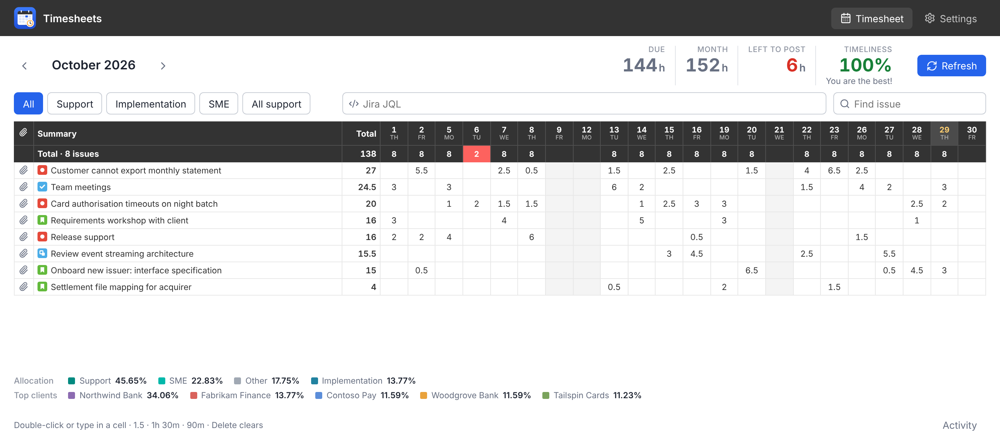

# Timesheets

A desktop app for managing your Jira worklogs in a monthly, spreadsheet-like grid. The easiest way to manage your daily worklogs.

You can add/modify your worklogs in several jira instances right in the table form - like in Excel

## Features

Timesheets selects jira issues by the following JQL via jira API, and represents the data in the grid:

```
(worklogAuthor = currentuser() AND worklogDate >= startOfMonth(0) AND worklogDate <= endOfMonth(0))
```



Now you can add new worklog or update an existing one by just a double-click in a table cell. The application automatically registers/updates a worklog once the new value has been set.

You can set spent time either in hours in **decimals** (1.5) or in jira-like format (e.g. **1h 45m**).

You can optionally (see instructions below) set additional filters list (e.g. "Support tickets" / "Development"), see predefined filters for reference.

### How editing a cell maps to Jira

| Cell change | What is sent to Jira |
|---|---|
| empty → value | one new worklog, started at the configured time (default 09:00 local) |
| value goes up | the difference is added to that day's latest worklog |
| value goes down | worklogs are shortened, never deleted, as long as each can keep at least 1 minute (Jira's minimum) |
| cleared | all of your worklogs on that cell are deleted |

Lowering time avoids deletes because many Jira setups allow people to edit their own worklogs but not delete them. If your account cannot delete worklogs, clearing a cell keeps each worklog at 1 minute (the closest value Jira allows) and the Activity log says so.

The app asks for confirmation before deleting more than one worklog, or any worklog that has a comment. Comments and start times of existing worklogs are kept.

## First Run

Builds are not signed with a paid certificate, so expect a warning on first launch:

- **Windows**: SmartScreen shows "Windows protected your PC". Click **More info → Run anyway**.
- **macOS**: the app is ad-hoc signed, but it is not notarized. On first launch macOS says it cannot verify the app. Go to **System Settings → Privacy & Security** and click **Open Anyway**. Alternatively, remove the download quarantine in Terminal:

  ```bash
  xattr -cr "/Applications/Timesheets.app"
  ```

## Setup

1. Open **Settings**. On first launch the app opens there automatically.
Set login and password. The credentials stored securily in macOS Keychain / Windows Credential Locker.
2. Click **Test connection**, then **Save settings**.
3. Optionally add project filters, the worklog start time, the daily norm and the time format.

Settings are stored in the app's profile folder. The exact path is shown at the bottom of Settings.

## Develop

```bash
npm install
npm run dev        # Electron + Vite with hot reload
npm run dev:web    # browser only, with built-in demo data (no Jira needed)
npm test           # unit + UI tests (Vitest)
```

## Build

```bash
npm run dist           # Windows portable   → release/Timesheets-<version>-portable.exe (no install needed)
npm run dist:installer # Windows installer  → release/Timesheets-<version>-setup.exe
npm run dist:mac       # macOS dmg (run on a Mac)
```

The GitHub Actions workflow `.github/workflows/build.yml` builds the Windows portable .exe and the macOS installers when you push a `v*` tag, and attaches them to the release. You can also run it manually.

## Project layout

```text
electron/
  main.cjs          window + IPC handlers
  preload.cjs       window.timesheets bridge
  jira.cjs          Jira REST calls (search, worklogs, create/update/delete)
  jira-core.cjs     pure helpers: JQL, auth, mapping (unit-tested)
  storage*.cjs      settings file + encrypted secrets (unit-tested)
  domain.cjs        Windows domain / Mac DNS and name, for first-launch Jira presets
docs/
  screenshot.png    main window, for this README
src/
  TimesheetView.tsx grid, keyboard editing, filters, activity log
  SettingsView.tsx  Jira sources, filters, preferences
  timesheet.ts      pivot + cell edit planning (unit-tested)
  time.ts           time parsing/formatting, month helpers (unit-tested)
  devApi.ts         demo backend for the browser preview and tests
```
